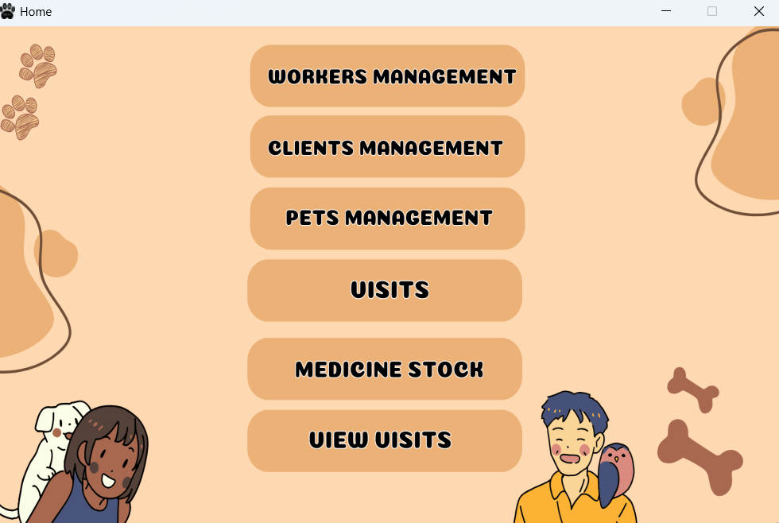
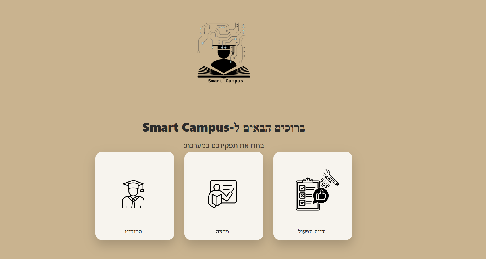
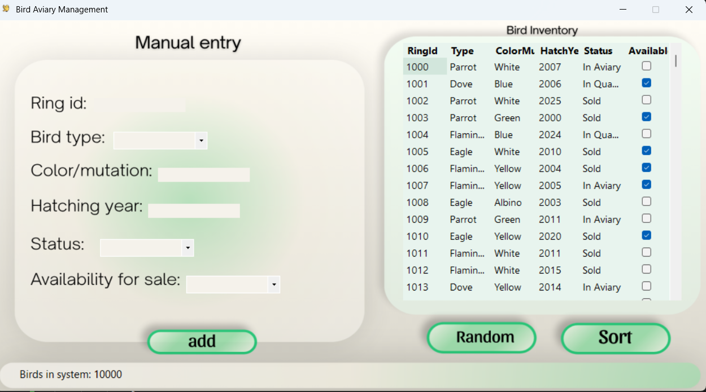

# Hi, I'm Yahav 👋

**Software Engineering Student @ SCE**  
Building practical applications across **Web, Desktop & Backend Development**.

I enjoy turning ideas into working products, with a focus on  
**software design, testing, database integration, and intuitive UX**.

Currently exploring **AI Integration & Software Security**.

 

---

## Featured Projects

### 🎓 Smart Campus
**Python · Flask · SQLite · Web Development**

A team-developed classroom reservation and infrastructure management system featuring role-based access, issue reporting, and AI-assisted triage.

🔗 https://github.com/yahav11/Smart-Campus

### ⏱️ Work Hours Tracking System
**Python · Streamlit · PostgreSQL · Supabase**

A web-based attendance tracking application featuring authentication, daily check-in/out, vacation reporting, monthly summaries, and Excel export.

🔗 https://github.com/yahav11/Work--Hours--Tracking-System

### 🐦 Bird Aviary Management
**C# · .NET · WinForms · MSTest**

A desktop inventory management system featuring input validation, sorting algorithms, reporting, and automated unit testing.

Applied interface-based dependency injection and mock implementations to test business logic independently.

🔗 https://github.com/yahav11/BirdAviaryManagement

### 🐾 Veterinary Clinic Management
**C# · WinForms · SQLite · OOP**

A team-developed veterinary clinic management system featuring role-based access, client and pet management, visit records, medicine inventory, and input validation.

🔗 https://github.com/yahav11/VetClinic

### 🤖 AI Study Planner
**Python · Streamlit · OpenAI API**

A study planning demo exploring the integration of AI capabilities into practical productivity applications.

🔗 https://github.com/yahav11/ai-study-planner

---

## Project Previews

<table>
  <tr>
    <td align="center" width="33%">
      
       
      <b>Vet Clinic</b>
    </td>
    <td align="center" width="33%">
      
       
      <b>Smart Campus</b>
    </td>
    <td align="center" width="33%">
      
       
      <b>Bird Aviary</b>
    </td>
  </tr>
</table>

---

## Engineering & Design

I enjoy working across different parts of software development, from implementing business logic and integrating databases to designing interfaces that feel intuitive.

I care about **maintainable code, thoughtful architecture, testing, and user experience**.

Because functional software should also feel good to use — not like a 2009 government website 😭

---

## Technologies & Tools

  
  
  
  
  
  
  
  
  
  
  
  
  

 

  Thanks for stopping by ✨

